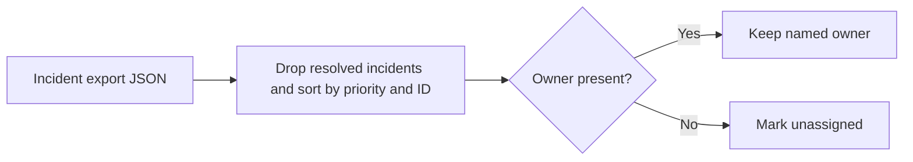

# On-call Handoff Assistant

Build a priority-ordered handoff list from an exported incident list. Resolved incidents are omitted and missing owners are marked `unassigned`. Lower priority numbers appear first.

## Run

Save the following as `incidents.json`, then run `python3 assistant.py incidents.json`.

```json
[{"id":"INC-1","priority":1,"status":"open"},{"id":"INC-2","priority":2,"status":"resolved","owner":"Platform"}]
```

The result contains `INC-1`, priority `1`, and owner `unassigned`. The tool reads local JSON and makes no changes to incident records.

## Local verification

Run `make verify` with Make and Python 3 installed. The target runs the documented sample through the project CLI.

## Project walkthrough



[Architecture and data flow](docs/ARCHITECTURE.md) · [Business problem, demo, and verification](docs/CASE_STUDY.md)
