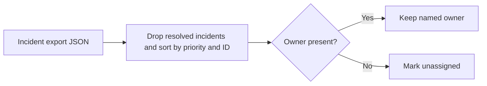

# On-call Handoff Assistant

Shift transitions can lose unresolved incidents or ownership information. The incoming responder needs an ordered handoff with unassigned work called out.

## What I built

I built a shift handoff CLI that removes resolved incidents, sorts the remaining work by priority and ID, and marks missing owners as unassigned.

## How it works



[Architecture](docs/ARCHITECTURE.md) · [Decision rules and source](docs/RULES.md)

## Tools used

| Tool | Role in this repository |
| --- | --- |
| Python | [assistant.py](assistant.py) implements the CLI and decision rules. Uses `argparse` to parse command-line options, `json` to read or write structured records, `pathlib` to read local files. |
| Make | Runs the documented example and the local `unittest` suite. |
| Python replay runner | Compares actual stdout with the checked-in baseline fixtures. |
| Ruff and Bandit | Developer lint and static security checks through `make check`. |

## Run the project

Use Python 3.10+ and Make. From the repository root:

```sh
python3 assistant.py example.json
```

The fixture keeps INC-1 with priority 1 and highlights that it needs an owner. [Full expected output](examples/Demo%201.stdout.txt)

## Verify the project

```sh
make verify
make replay
```

`make replay` checks the recorded cases and exits nonzero if the output changes.
See the [developer guide](docs/DEVELOPMENT.md) for the pinned lint and security tools.

## Operating limits

The project reads a local export and does not reassign or update incidents in a ticketing system.

[Case study](docs/CASE_STUDY.md) · [Operator runbook](docs/RUNBOOK.md) · [Verification report](reports/verification.md)
