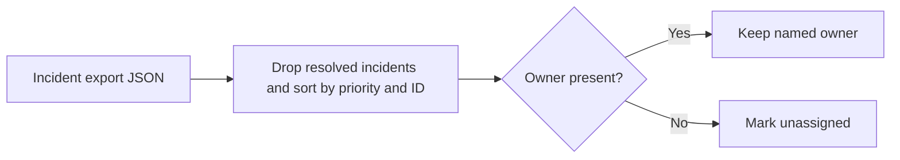

# On-call Handoff Assistant

Build a priority-ordered handoff list from an exported incident list. Resolved incidents are omitted and missing owners are marked `unassigned`. Lower priority numbers appear first.

## Run

Save the following as `incidents.json`, then run `python3 assistant.py incidents.json`.

```json
[{"id":"INC-1","priority":1,"status":"open"},{"id":"INC-2","priority":2,"status":"resolved","owner":"Platform"}]
```

The result contains `INC-1`, priority `1`, and owner `unassigned`. The tool reads local JSON and makes no changes to incident records.

## Local verification

Run `make verify` with Make and Python 3 installed. The target runs the documented sample through the project CLI.

## Business problem

Shift transitions can lose unresolved incidents or ownership information. The incoming responder needs an ordered handoff with unassigned work called out.

## Project walkthrough



[Architecture and data flow](docs/ARCHITECTURE.md) · [Business problem, demo, and verification](docs/CASE_STUDY.md)

## Run the project

### Local setup

Run `make verify` with Python 3 and Make installed.

### CLI usage

```sh
python3 assistant.py example.json
```

### Replay usage

Run `make replay` to replay the checked-in inputs. The runner compares stdout with the baseline, reports differences, and exits nonzero on regression.

[Replay cases](examples/replay-manifest.json) · [Generated report](reports/replay.md) · [Rule implementation](docs/RULES.md)

### Run tests

[Verification report](reports/verification.md) · [Business problem, sample behavior, and limitations](docs/CASE_STUDY.md)


### Limitations

The verification report covers the bundled local examples. See the [case study](docs/CASE_STUDY.md) for project-specific assumptions and operating limits.

## Development and security

See the [developer setup, tool roles, and security checks](docs/DEVELOPMENT.md).

[Local check results](reports/devsecops.md)
