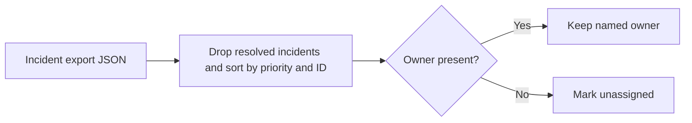

# On Call Handoff Assistant architecture

Build a priority-ordered handoff list from an exported incident list. Resolved incidents are omitted and missing owners are marked `unassigned`. Lower priority numbers appear first.

## Operational boundaries

The documented run evaluates the bundled sample locally. Results depend on the quality and scope of the input. The demo makes no live infrastructure changes.
